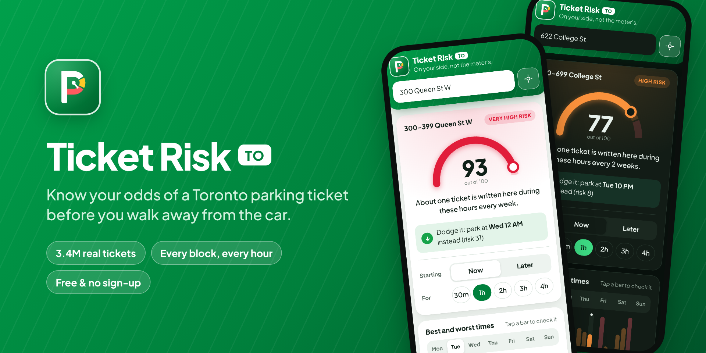
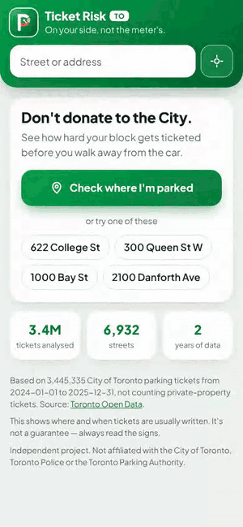
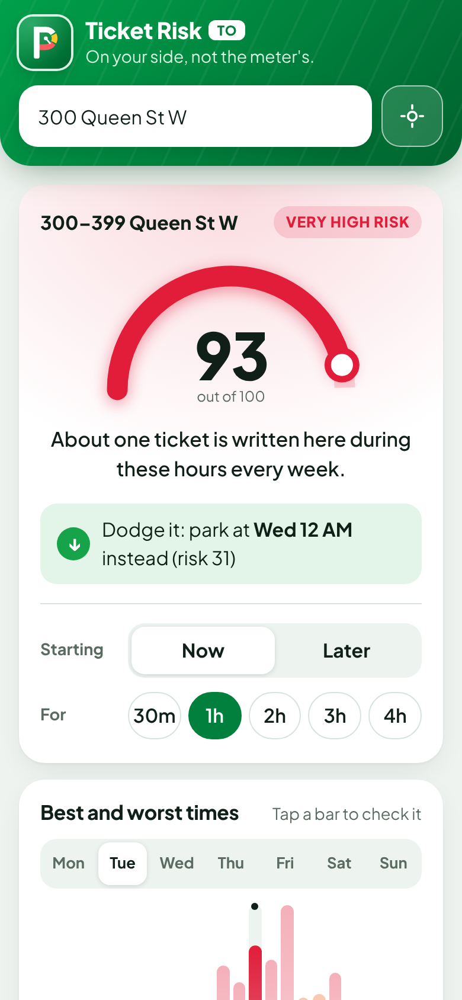
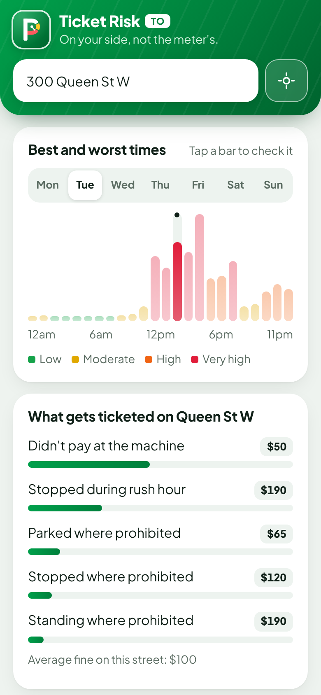
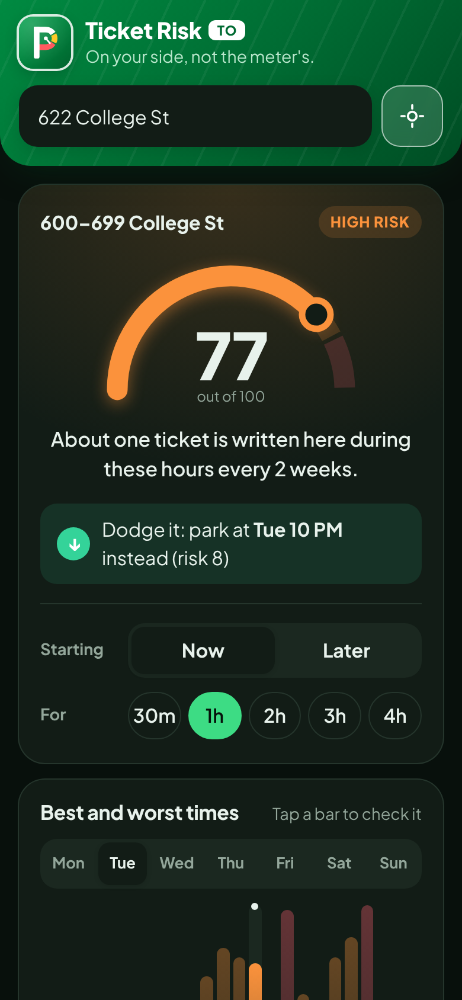

<div align="center">



# Ticket Risk TO

**Know your odds of a Toronto parking ticket — before you walk away from the car.**

Parking-sign green, but on the driver's side. Free, no sign-up, works on any phone.

[](https://app.netlify.com/start/deploy?repository=https://github.com/msanvarov/toronto-parking-risk)
&nbsp;
[](https://vercel.com/new/clone?repository-url=https://github.com/msanvarov/toronto-parking-risk)


</div>

---

## Toronto writes about 2 million parking tickets a year. Don't get one of them.

Pull over, tap **"Check where I'm parked"**, and in a second you'll know how hard your block gets ticketed at this exact hour, based on **3.4 million real City of Toronto tickets**.

<table>
  <tr>
    <td align="center" width="25%"><br><sub><b>One tap, one answer</b></sub></td>
    <td align="center" width="25%"><br><sub><b>A clear 0–100 score</b></sub></td>
    <td align="center" width="25%"><br><sub><b>Best and worst times</b></sub></td>
    <td align="center" width="25%"><br><sub><b>Dark mode built in</b></sub></td>
  </tr>
</table>

### What you get

- 🎯 **A risk score for your exact block and hour.** Not the whole street, not the whole day: the 100-block you're on, for the time you'll be there.
- 💬 **Plain English.** "About one ticket is written here during these hours every 2 weeks."
- ↪️ **"Dodge it" tips.** When it's risky, it tells you the nearest quieter time.
- 📊 **Best and worst times.** Hour-by-hour bars for every day of the week. Tap one to check it.
- 💸 **What actually gets ticketed and what it costs.** Meter, rush hour, permit, hydrant — with real fines.
- 📍 **No typing needed.** Uses your phone's location to find the street you're on.
- 📲 **Install it like an app.** Add to your home screen. Works offline for streets you've already checked.
- 🔒 **Private by design.** No accounts, no tracking, no server. Your location goes to OpenStreetMap only when you tap the button, just to find the street name.

### Try these

| Address | Tuesday at lunch | Why |
| --- | --- | --- |
| 300 Queen St W | **93 — Very high** | Meters + rush-hour routes, enforced constantly |
| 622 College St | **77 — High** | Little Italy pay-and-display, busiest midday and evenings |
| 2100 Danforth Ave | **25 — Moderate** | Quieter east-end stretch |

---

## How the score works

The score comes from the City of Toronto's [parking ticket dataset](https://open.toronto.ca/dataset/parking-tickets/): about 3.4 million tickets from 2024–2025.

1. Tickets are grouped by street and 100-block (e.g. 600–699 College St), and counted by hour of day and day of week.
2. For your block and time, the app estimates how many tickets are written there in that hour in a typical week.
3. That number is compared against every block and hour in the city. A score of 80 means 80% of all tickets are written at quieter places or times.
4. For a stay longer than an hour, the busiest hour in the window counts. One bad hour is enough to get a ticket.

| Score | Label |
| --- | --- |
| 0–24 | Low |
| 25–59 | Moderate |
| 60–84 | High |
| 85–100 | Very high |

Things to know:

- **It measures enforcement, not your personal odds.** The data says where and when tickets get written, not how many cars were parked there.
- **Private-property tickets are left out** (infraction code 3, ~19% of all tickets), since they're about lots and driveways, not street parking.
- **Searching a street without a number** uses the average block on that street.
- **Blocks with fewer than 5 tickets in two years** aren't stored; the app treats them as very quiet.
- The dataset has addresses but no coordinates. "Check where I'm parked" turns your GPS position into an address with [OpenStreetMap Nominatim](https://nominatim.org/), only when you tap the button.

## Tech stack

| Part | What it uses |
| --- | --- |
| App | React 18 + TypeScript, built with Vite 5 |
| Styling | Plain CSS with light/dark themes, Plus Jakarta Sans (self-hosted via Fontsource) |
| Offline / install | Web app manifest + a small hand-written service worker (`public/sw.js`) |
| Data | Static JSON in `public/data/`, built by a Python 3 script (standard library only) |
| Location | Browser geolocation + OpenStreetMap Nominatim for street lookup |
| Tests | Vitest |
| Backend | None. It's a fully static site, so no server, database or API keys |

## Run it locally

Needs Node 20+ (22 recommended, see `.nvmrc`). Python 3.9+ only if you rebuild the data.

```bash
npm install
npm run dev      # http://localhost:5173
npm test
npm run build
```

## Deploy

It's a static site: build with `npm run build` and serve the `dist/` folder. No environment variables are needed. The ticket data is already committed, so Python isn't needed at build time.

| Host | Setup |
| --- | --- |
| **Netlify** | Click the button above, or "Add new site → Import from Git". `netlify.toml` sets the build command, folder, Node version and cache headers. |
| **Vercel** | Click the button above, or import the repo. It detects Vite automatically. |
| **Cloudflare Pages** | Framework preset "Vite", build command `npm run build`, output `dist`, env var `NODE_VERSION=22`. |
| **GitHub Pages** | Settings → Pages → Source: **GitHub Actions**. `.github/workflows/deploy.yml` deploys every push to `main`. |
| **Anywhere else** | Upload the contents of `dist/` to any static host or bucket (S3, Firebase Hosting, Render static site…). |

Hosting under a sub-path (like `example.com/parking/`)? Build with `BASE_PATH=/parking/ npm run build`.

The site needs HTTPS for "Check where I'm parked" to work. All the hosts above provide it.

## Keeping the data fresh

The City publishes each year's tickets once, usually in March–May of the following year. The app uses the newest two years.

**It's automatic:** `.github/workflows/update-data.yml` checks on the 1st of every month. When a new year is out, it rebuilds the data and opens a pull request. Merge it and your host redeploys.

To do it by hand:

```bash
npm run data                                         # newest 2 years published
python3 scripts/build_data.py --check                # is a newer year out?
python3 scripts/build_data.py --years 2023 2024 2025 # any years
python3 scripts/build_data.py --exclude-codes        # keep private-property tickets
```

The script downloads the yearly ZIPs into `data-raw/` (git-ignored) and writes `public/data/` (~4 MB, split into 64 files so the app only downloads the street you look up).

## Project layout

```
scripts/build_data.py   download + aggregate ticket data into public/data/
src/lib/normalize.ts    street-name matching (mirrors the Python rules)
src/lib/data.ts         data loading, sharding, search
src/lib/risk.ts         scoring
src/lib/geo.ts          GPS + reverse geocoding
src/components/         UI pieces
public/sw.js            offline cache
docs/                   README screenshots and social preview image
```

## Disclaimer

This shows patterns from past tickets. It's not legal advice and not a guarantee. Always read the signs.

Data: Contains information licensed under the [Open Government Licence – Toronto](https://open.toronto.ca/open-data-license/).

Independent project. Not affiliated with the City of Toronto, Toronto Police or the Toronto Parking Authority (Green P).
